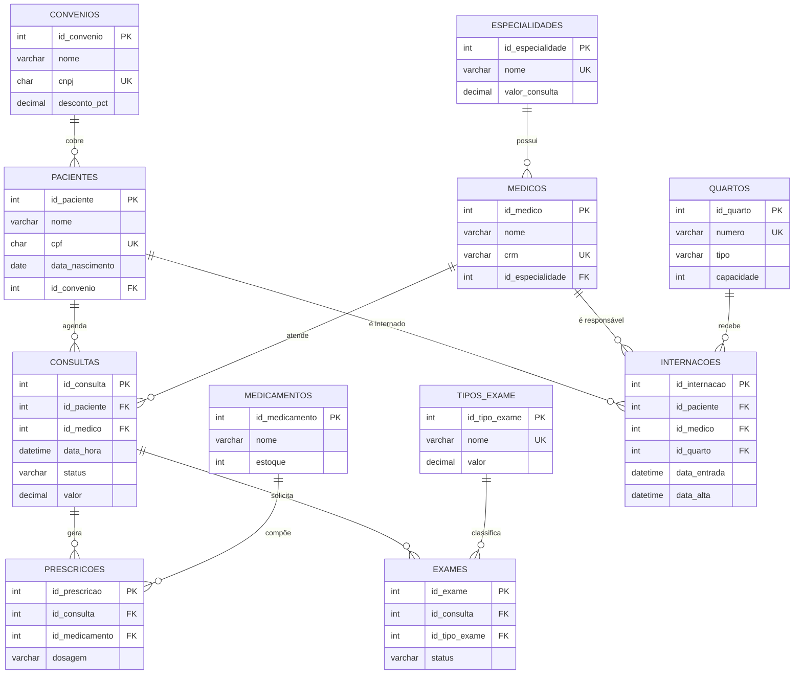

# 🏥 Sistema Hospitalar em SQL

Banco de dados relacional para a gestão de um hospital: **pacientes, médicos, consultas, exames, prescrições e internações**.

Projeto feito para praticar modelagem de dados e SQL: chaves primárias e estrangeiras, constraints, índices, views, procedures, transações e consultas com JOIN, GROUP BY e subconsultas.


---

## 📋 Funcionalidades

- Cadastro de **pacientes** com convênio ou atendimento particular
- Cadastro de **médicos** com especialidade e CRM único
- **Agendamento de consultas**: o valor é calculado automaticamente com o desconto do convênio
- Bloqueio de **dois agendamentos no mesmo horário** para o mesmo médico
- **Prescrição de medicamentos** e controle de estoque
- **Pedidos de exames** com acompanhamento de resultados
- **Internações** com controle de vagas por quarto, alta e custo total
- **Relatórios** prontos: faturamento mensal, ocupação de quartos, exames pendentes e mais

---

## 🗂️ Estrutura do projeto

```
sistema-hospitalar-sql/
├── README.md
└── sql/
    ├── 01_schema.sql             # cria o banco, as tabelas, as chaves e os índices
    ├── 02_dados.sql              # dados fictícios para teste
    ├── 03_views_procedures.sql   # views (relatórios) e procedures (regras de negócio)
    └── 04_consultas.sql          # 20 consultas de exemplo + operações de INSERT/UPDATE/DELETE
```

> ⚠️ Rode os arquivos **na ordem** (01 → 02 → 03 → 04).

---

## 🧩 Modelo de dados (DER)



### Tabelas

| Tabela | Descrição |
|---|---|
| `convenios` | Planos de saúde e o percentual de desconto de cada um |
| `pacientes` | Dados pessoais, tipo sanguíneo e convênio (NULL = particular) |
| `especialidades` | Especialidades médicas e o valor base da consulta |
| `medicos` | Médicos, CRM e especialidade |
| `consultas` | Agendamentos com status `AGENDADA`, `REALIZADA`, `CANCELADA` ou `FALTOU` |
| `medicamentos` | Catálogo de medicamentos e estoque |
| `prescricoes` | Medicamentos receitados em cada consulta |
| `tipos_exame` | Catálogo de exames, preparo e valor |
| `exames` | Exames pedidos em cada consulta e seus resultados |
| `quartos` | Quartos (`ENFERMARIA`, `APARTAMENTO`, `UTI`), capacidade e diária |
| `internacoes` | Internações; `data_alta` NULL significa que o paciente ainda está internado |

### Views

| View | O que mostra |
|---|---|
| `vw_agenda_consultas` | Consultas com nome do paciente, médico, especialidade e convênio |
| `vw_pacientes_internados` | Quem está internado agora, há quantos dias e o custo parcial |
| `vw_ocupacao_quartos` | Leitos ocupados e vagas livres por quarto |
| `vw_faturamento_mensal` | Total faturado com consultas realizadas por mês |
| `vw_exames_pendentes` | Exames aguardando resultado e há quantos dias |

### Procedures

| Procedure | O que faz |
|---|---|
| `sp_agendar_consulta(paciente, medico, data_hora, motivo)` | Agenda a consulta já aplicando o desconto do convênio; recusa datas passadas e médicos inativos |
| `sp_internar_paciente(paciente, medico, quarto, alta_prevista, motivo)` | Interna o paciente se houver vaga no quarto e ele não estiver internado |
| `sp_dar_alta(id_internacao)` | Registra a alta e mostra o custo total da internação |

---

## 🚀 Como rodar

### Pré-requisitos

- **MySQL 8.0+** (ou **MariaDB 10.5+**)
- Um cliente SQL: terminal do MySQL **ou** [MySQL Workbench](https://dev.mysql.com/downloads/workbench/)

### Opção 1: pelo terminal

Clone o repositório e entre na pasta:

```bash
git clone https://github.com/SEU-USUARIO/sistema-hospitalar-sql.git
cd sistema-hospitalar-sql
```

Execute os scripts na ordem (vai pedir a senha do seu usuário do MySQL):

```bash
mysql -u root -p < sql/01_schema.sql
mysql -u root -p < sql/02_dados.sql
mysql -u root -p < sql/03_views_procedures.sql
```

Depois entre no MySQL e teste:

```bash
mysql -u root -p hospital
```

```sql
SELECT * FROM vw_agenda_consultas;
```

Para rodar todas as consultas de exemplo de uma vez:

```bash
mysql -u root -p -t < sql/04_consultas.sql
```

> 💡 **Windows (PowerShell):** o `<` não funciona no PowerShell. Use o CMD ou entre no MySQL e rode com `source`:
> ```sql
> source C:/caminho/para/sistema-hospitalar-sql/sql/01_schema.sql
> source C:/caminho/para/sistema-hospitalar-sql/sql/02_dados.sql
> source C:/caminho/para/sistema-hospitalar-sql/sql/03_views_procedures.sql
> ```

### Opção 2: pelo MySQL Workbench

1. Abra o Workbench e conecte no seu servidor local.
2. Vá em **File → Open SQL Script** e abra o `sql/01_schema.sql`.
3. Clique no **raio ⚡** (Execute) para rodar o script inteiro.
4. Repita com `02_dados.sql` e `03_views_procedures.sql`, nessa ordem.
5. Clique com o botão direito em **Schemas → Refresh All** para ver o banco `hospital`.
6. Abra o `04_consultas.sql`, coloque o cursor numa consulta e use **Ctrl + Enter** para rodar só ela.

### Opção 3: com Docker (sem instalar o MySQL)

```bash
# sobe um MySQL 8 já com a senha "root"
docker run --name hospital-db -e MYSQL_ROOT_PASSWORD=root -p 3306:3306 -d mysql:8

# espere uns 20 segundos o banco iniciar e rode os scripts
docker exec -i hospital-db mysql -uroot -proot < sql/01_schema.sql
docker exec -i hospital-db mysql -uroot -proot < sql/02_dados.sql
docker exec -i hospital-db mysql -uroot -proot < sql/03_views_procedures.sql

# abre o terminal do MySQL dentro do container
docker exec -it hospital-db mysql -uroot -proot hospital
```

> ℹ️ O `01_schema.sql` começa com `DROP DATABASE IF EXISTS hospital`, então rodar de novo **recria o banco do zero**.

---

## 🔎 Exemplos de uso

**Próximas consultas agendadas**

```sql
SELECT data_hora, paciente, medico, especialidade, convenio
FROM vw_agenda_consultas
WHERE status = 'AGENDADA'
ORDER BY data_hora;
```

**Faturamento por especialidade**

```sql
SELECT e.nome AS especialidade,
       COUNT(c.id_consulta) AS consultas,
       COALESCE(SUM(c.valor), 0) AS faturamento
FROM especialidades e
LEFT JOIN medicos   m ON m.id_especialidade = e.id_especialidade
LEFT JOIN consultas c ON c.id_medico = m.id_medico AND c.status = 'REALIZADA'
GROUP BY e.id_especialidade, e.nome
ORDER BY faturamento DESC;
```

**Agendar uma consulta (o desconto do convênio é aplicado sozinho)**

```sql
CALL sp_agendar_consulta(1, 2, '2030-01-10 09:00:00', 'Avaliação de rotina');
```

**Ver ocupação dos quartos**

```sql
SELECT * FROM vw_ocupacao_quartos;
```

O arquivo [`sql/04_consultas.sql`](sql/04_consultas.sql) tem **20 consultas comentadas**, do `SELECT` simples até subconsultas, além de exemplos de `INSERT`, `UPDATE`, `DELETE` e `CALL` dentro de uma transação com `ROLLBACK` (dá pra testar sem bagunçar os dados).

---

## 🛡️ Regras de integridade aplicadas

- **CPF, CRM, CNPJ** e número do quarto são únicos (`UNIQUE`)
- `CHECK` em status, sexo, tipo sanguíneo, tipo de quarto, valores e datas (a alta não pode ser antes da entrada, por exemplo)
- Um médico **não pode ter duas consultas no mesmo horário**
- Não é possível apagar um médico ou paciente que tenha consultas (`ON DELETE RESTRICT`)
- Ao apagar uma consulta, suas prescrições e exames são apagados juntos (`ON DELETE CASCADE`)
- Se um convênio for removido, o paciente passa a ser particular (`ON DELETE SET NULL`)

---

## 🛠️ Conceitos de SQL praticados

`CREATE TABLE` · `PRIMARY KEY` · `FOREIGN KEY` · `UNIQUE` · `CHECK` · `DEFAULT` · `INDEX` · `INSERT` · `UPDATE` · `DELETE` · `INNER JOIN` · `LEFT JOIN` · `GROUP BY` · `HAVING` · `CASE` · subconsultas · funções de data (`TIMESTAMPDIFF`, `DATEDIFF`, `DATE_FORMAT`) · `VIEW` · `STORED PROCEDURE` · `SIGNAL` (erros personalizados) · transações (`START TRANSACTION` / `ROLLBACK`)

---

## 📝 Observações

- Todos os dados são **fictícios**: nomes, CPFs e CNPJs foram inventados.
- Testado em MariaDB 10.11; escrito para ser compatível com MySQL 8.0.16+ (versão em que o `CHECK` passou a ser aplicado).

---

## 👤 Autor

Feito por **SEU NOME**: [LinkedIn](https://www.linkedin.com/in/SEU-PERFIL) · [GitHub](https://github.com/SEU-USUARIO)
